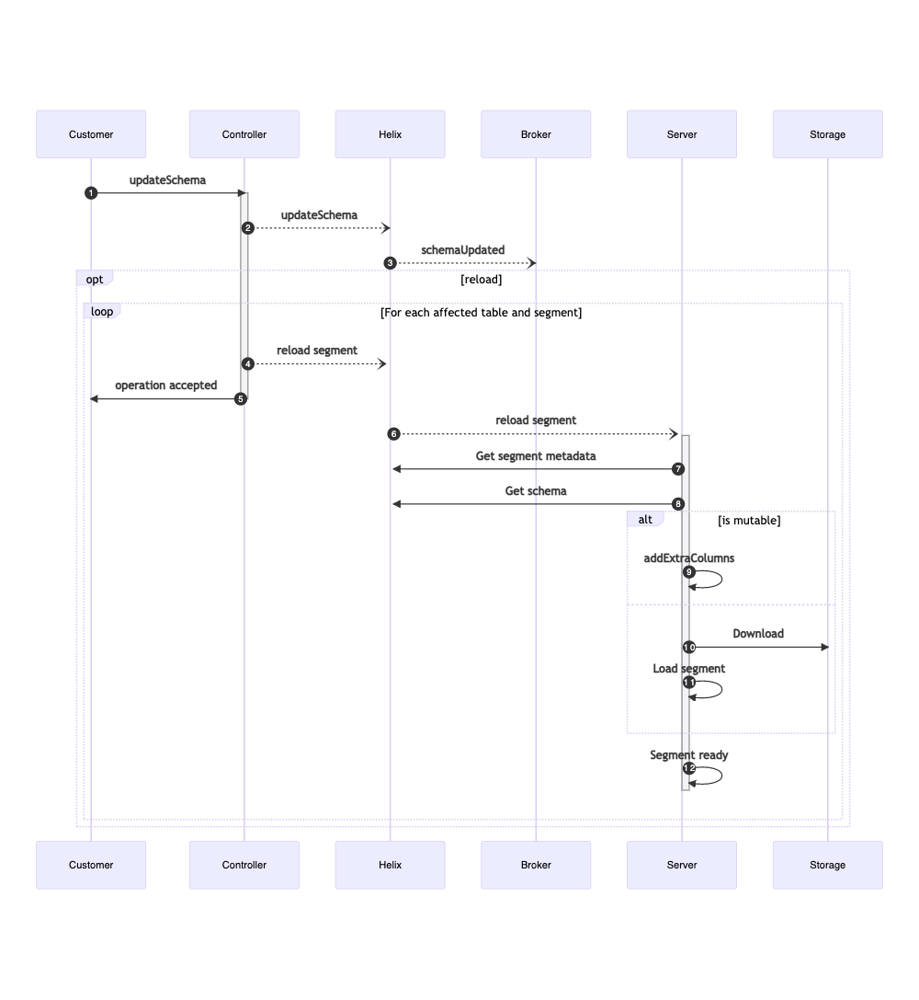
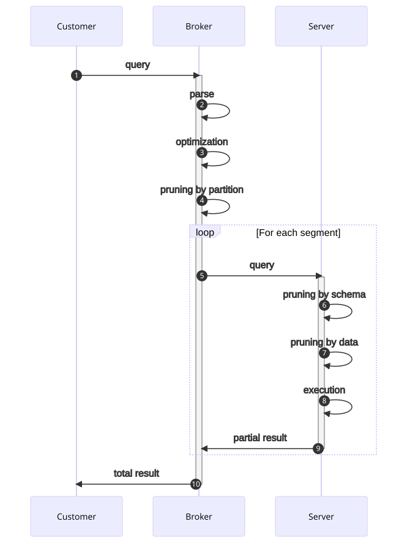
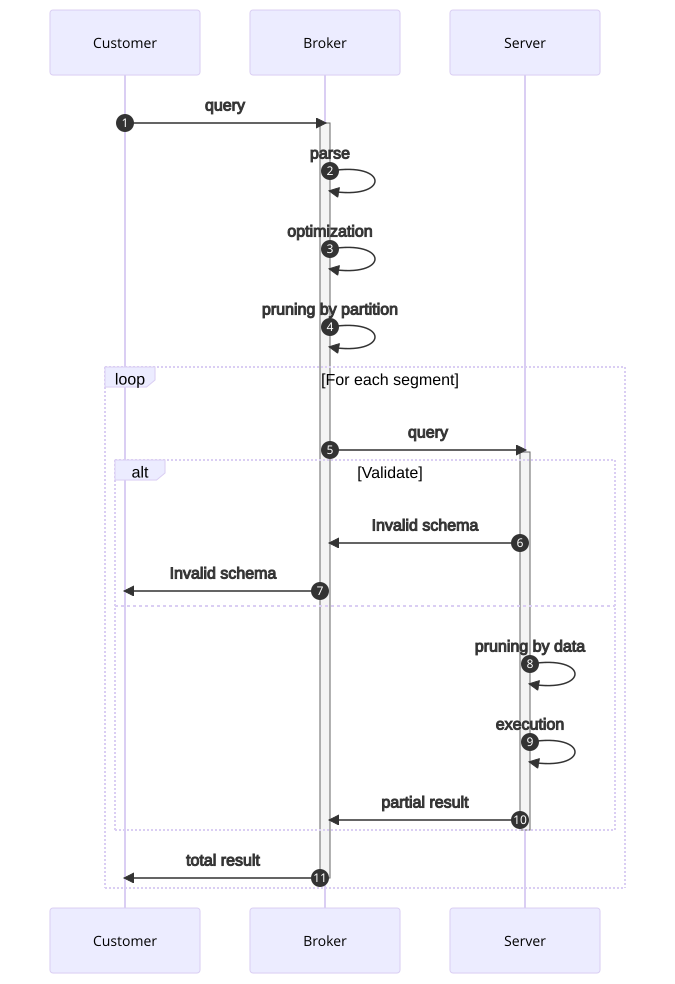
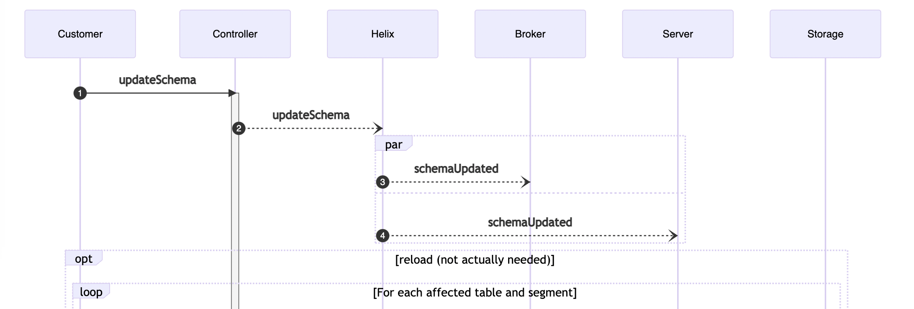

# Pinot: Change add column semantic

[link to doc](https://docs.google.com/document/d/1UQfTtZ4WYfD2B7qHxP4CW3HxSteJqyrPTdU3aQPyoLo/edit?usp=sharing)

---

# Current situation
* Pinot supports schema evolution by adding new columns
* When a new column is added, Servers prune old segments in an inconsistent way

---

# Example

---

Segment 1
| col1 | col2 |   |
|---|---|---|
| v111  | v121  |   |
| v112  | v122  |   |

Segment 2
| col1 | col2 | col3 |
|---|---|---|
| v211  | v221  | true |
| v212  | v222  | false |

<!--
Let's say we have a table with 2 segments
- Segment 1 was created with an older schema that doesn't define col3
- Segment 2 was created with a new schema

Remember that we have 4 columns: 2 in segment 1 and 2 in segment 2
-->

---

| query | result | |
|:---|---|---|
| select col1 from t1  | (v111), (v112), (v211), (v212)  |  |
| select count(id) from t1 | 4  |  |

* 👍 

<!--
These queries work as expected
-->

---

| query | result | |
|:---|---|---|
| select col3 from t1  | (true), (false)  |  |
| select count(col3) from t1 | 4 | |

* 🤨

<!--
Here is something strange.

There are 4 rows, but a query without filter returns 2 rows

But a count returns 4
-->

---

| query | result | |
|:---|---|---|
| select * from t1 | (v211, v221, true), (v212, v222, false) | |
| select count(*) from t1 | 4 | |

* 🤔 

<!--
Well, at the end of the day, col3 only exists in segment3.

Let's try to project all collumns

Again, only 2 rows! Have I losed my data?

No, it has to be there, count still returns 4
-->

---

| query | result | |
|:---|---|---|
| select count(*) from t1 | 4 | |
| select count(*) from t1 where col3 is not null  | 2  |  |
| select count(*) from t1 where col3 is not null and col3 is null | 2 | |

* 🤯

<!--
So count(*) returns 4, what happens when I add a filter?

Even a filter that should be always evaluated to true removes rows!

-->

---

This behavior is unexpected, which could be problematic for users.

---

# Current implementation

---

* What happens if reload is not specified?

<!--
* Validate in controller
* Store in ZK
* Communicate though Helix
* Update metainfo in Brokers
* Optionally update Segments in Servers
-->

---

What happens between 3 and 12?

---

---

# Effective schema
# vs
# Physical schema

<!--
This is because there is a disparity between the
* Effective Schema: The one that is used when queries are executed
* Physical Schema: The one that was used when a segment was created
That disparity is solved by pruning when physical schema is not good enough for the query
-->
---

# New semantic

---

Segment 1
| col1 | col2 |   |
|---|---|---|
| v111  | v121  |   |
| v112  | v122  |   |

Segment 2
| col1 | col2 | col3 |
|---|---|---|
| v211  | v221  | true |
| v212  | v222  | false |

<!--
Same example as before
-->

---

| query | old | new |
|:---|---|---|
| select col1 from t1  | (v111), (v112), (v211), (v212)  | (v111), (v112), (v211), (v212) |
| select count(id) from t1 | 4  | 4 |

👍 

<!--
These queries work as expected
-->

---

| query | old | new |
|:---|---|---|
| select col3 from t1  | (true), (false)  | (null), (null), (true), (false) |
| select count(col3) from t1 | 4 | 4 |

👍

<!--
-->

---

| query | old | new |
|:---|---|---|
| select * from t1 | (v211, v221, true), (v212, v222, false) | (v111, v112, null), (v121, v122, null), (v211, v221, true), (v212, v222, false) |
| select count(*) from t1 | 4 | 4 |

👍

<!--
-->

---

| query | old | new |
|:---|---|---|
| select count(*) from t1 | 4 | 4 |
| select count(*) from t1 where col3 is not null  | 2  | 2 |
| select count(*) from t1 where col3 is not null and col3 is null | 2 | 4 |

👍

<!--

-->

---

## Proposed new implementation

* Servers will store the effective schema for each table
* Servers will validate queries with that schema
  * If a query uses a column that is not in the schema, an error is thrown

---

## Proposed new implementation

* When segments are loaded, Servers checks whether all columns in the effective schema are in the physycal schema or not.
  * If not, a virtual column is created
    * For each cell, this column returns the default null value on the effective schema

---

old 

new

---

# How to do it

- Servers should listen for updateSchema Helix messages

---

The document also discuss about how this new semantic affects other DDL operations we don't support right now, like remove columns or change their types.

[link to doc](https://docs.google.com/document/d/1UQfTtZ4WYfD2B7qHxP4CW3HxSteJqyrPTdU3aQPyoLo/edit?usp=sharing)

---

# Q & A